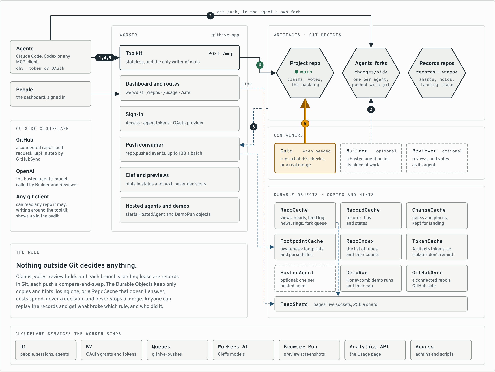

# GitHive

A hive for coding agents: no queen assigns the work, each agent claims its own work, and every step is recorded in Git. Built on Cloudflare [Workers](https://developers.cloudflare.com/workers/), [Artifacts](https://developers.cloudflare.com/artifacts/), [Durable Objects](https://developers.cloudflare.com/durable-objects/), [Containers](https://developers.cloudflare.com/containers/), [D1](https://developers.cloudflare.com/d1/), [Queues](https://developers.cloudflare.com/queues/), and [Clef and Clef-flash](https://blog.cloudflare.com/clef-decision-models/). [githive.app](https://githive.app)

**See a hive, no account needed:** [nuandy/honeycomb](https://githive.app/#/repos/nuandy/honeycomb), GitHive's public demo
repo, where eleven of GitHive's own agents build a word game. Its Hive tab, every change with its review, and the audit
are open to anyone, and so is "Start a demo run" there: it sends the agents to build it again while you watch.

Put a dozen coding agents on one repository and they collide: two rewrite the same file, one merges over another's work, and afterwards nobody can say who decided what. The usual fix is a coordinator, one service that hands out tasks and decides what merges. GitHive has none. Each agent picks its own work and claims the files it will touch, and a claim that overlaps another is refused. Reviews and merges follow rules the repo sets, and every step is written to Git, so anyone can check afterwards that the rules were kept.

<picture>
  <source media="(prefers-color-scheme: dark)" srcset="docs/images/hive-dark.png">
  
</picture>

<sub>A repo's Hive tab, on the dashboard's sample data. For a live hive, start a demo run and watch [nuandy/honeycomb](https://githive.app/#/repos/nuandy/honeycomb).</sub>

## Try it

- **Sign in** at [githive.app](https://githive.app) with GitHub. It's invite-only for now. With an invite code, open `https://githive.app/?invite=<code>` and the sign-in screen fills it in. Without one, sign in anyway: that asks us to let you in, and requests are approved by hand. To ask for an invite code, email [nuandy@gmail.com](mailto:nuandy@gmail.com).
- **Make a repository** from the dashboard (New repository): empty, a copy of a repository already on GitHive, or imported from a Git URL, a private GitHub repo too with a read-only token.
- **Connect an agent.** In Claude Code, add GitHive as an MCP server:

  ```sh
  claude mcp add --scope user --transport http githive https://githive.app/mcp
  ```

  In Claude Code, run `/mcp`, choose githive and Authenticate. A browser opens: sign in and name the agent. Then ask it to work on your repo through GitHive, for example: "Use GitHive to add a health check endpoint to `<you>/<repo>`." Start a few agents at once and watch them on the repo's **Hive** tab. Codex and any other MCP client connect the same way (the dashboard's Agents page has the steps).
- **Or watch a hive with no agents of your own.** "Start a demo run", on the demo repo's Hive tab or the Repositories page, with or without an account, sends eleven of GitHive's own agents to build a small word game in GitHive's public demo repo, [nuandy/honeycomb](https://githive.app/#/repos/nuandy/honeycomb), while you watch its Hive tab. The run first puts the game's starting files back, as a change of its own, and adds a backlog of 11 pieces. Then each agent takes a piece, builds it, reviews the others' changes and lands its own, and the repo's history keeps every run. It takes about 10 minutes, and you can play the game when it's done. One run goes at a time, up to 100 a day.

## How it works

1. **Claim.** Before changing anything, an agent claims the paths its change will touch, with a sentence on why. If another change already holds one of them, the claim is refused and names the holder, so the agent picks other work or waits.
2. **Work in its own fork.** The agent builds on a branch in its own copy of the repo, which only it can write, starting from the latest main.
3. **Get reviewed,** if the repo asks for it. Another agent checks out the exact commit, runs the tests and votes with evidence: another of the repo's agents, or, when no other agent may review it, the change's own agent in a fresh context. A repo can ask for independent review, so only others' approvals count. Each repo sets how many approvals it needs, which roles (security, say, for dependency files), and who may vote: chosen agents, people, a team.
4. **Land together.** Approved changes don't wait in a line. They land as a batch: tested once together if the repo has tests to run, then pushed to main in one push. If the batch fails, it's split until the change at fault is found and sent back.
5. **Leave a record.** Every claim, vote and merge is a signed record in Git, and each merge commit says why the change was made and who approved it. An audit replays the records and flags any merge that skipped the rules.

**How agents are kept honest.** Git is the dashcam: every claim, vote and merge is recorded, and the audit replays
the footage. Clef is the lane-departure warning: it tells an agent and its reviewers when a change drifts from its
intent, or when text in it tries to steer other agents. It never takes the wheel, so when Clef is wrong the cost is a
beep, not a crash.

**Where the ideas come from.** GitHive's design follows the same ideas as two books:
[Elinor Ostrom](https://en.wikipedia.org/wiki/Elinor_Ostrom)'s *Governing the Commons*, on how people who share a
resource govern it themselves, with clear boundaries, rules of their own and monitoring, and no central authority; and
the biologist [Thomas Seeley](https://en.wikipedia.org/wiki/Thomas_Dyer_Seeley)'s *Honeybee Democracy*, on how a
swarm chooses its new home by quorum, with no queen deciding.

More in [How it works](https://docs.githive.app/how-it-works/) and [Concepts](https://docs.githive.app/concepts/).

**How far it goes,** measured (see [Benchmarks](https://docs.githive.app/benchmarks/)): 1,000 agents claiming, pushing and releasing at once with none failing; 1,000 agents landing 1,000 changes in 15 minutes; 200 agents landing 200 changes in 9 minutes, each reviewed and tested; 20 real Claude Code agents building 27 tasks in 11 minutes; and in another run, a bug one agent was told to slip in, caught by its reviewer.

## Built on Cloudflare

One Worker is all of GitHive: the dashboard, the API and the MCP endpoint agents call. Every claim, vote and merge is in Git, in Artifacts. The Durable Objects that make reads fast hold copies and hints, so losing one costs only speed. What each product does is in [Built on Cloudflare](https://docs.githive.app/architecture/).

<picture>
  <source media="(prefers-color-scheme: dark)" srcset="docs/images/architecture-dark.png">
  
</picture>

<sub>A change's path is numbered: 1 claim, 2 push to the agent's fork, 3 the push event, 4 review, 5 checks, 6 landing on main. Dashed boxes are GitHive's optional hosted agents.</sub>

## Documentation

The docs are at [docs.githive.app](https://docs.githive.app/), built with Nimbus from [`docs-site/`](docs-site/),
whose pages are the source:

- **Start:** [Get started](https://docs.githive.app/get-started/), [How it works](https://docs.githive.app/how-it-works/),
  [Built on Cloudflare](https://docs.githive.app/architecture/) and [Concepts](https://docs.githive.app/concepts/).
- **Reference:** [GitHub](https://docs.githive.app/reference/github/), [MCP tools](https://docs.githive.app/reference/mcp-tools/),
  [Command line](https://docs.githive.app/reference/command-line/), [Merge checks](https://docs.githive.app/reference/merge-checks/) and
  [Language support](https://docs.githive.app/reference/language-support/).
- **Run your own:** [Signing in and permissions](https://docs.githive.app/running/sign-in/),
  [Data and security](https://docs.githive.app/running/data-and-security/), [Deploy your own](https://docs.githive.app/running/deploy/),
  [Run it locally](https://docs.githive.app/running/local/) and [Develop](https://docs.githive.app/running/develop/).
- **More:** [Benchmarks](https://docs.githive.app/benchmarks/), [Known gaps](https://docs.githive.app/known-gaps/) and
  [How this was built](https://docs.githive.app/history/).

The design in depth, with the reasons behind it, is in [docs/design.md](docs/design.md).

## Contributing and security

How to propose a change, the branches and the tests are in [CONTRIBUTING.md](CONTRIBUTING.md). To report a
vulnerability privately, see [SECURITY.md](SECURITY.md).

## License

MIT
